# A tour of the screens

Last revised: 2026-11-07.

What each screen looks like and how it is used, for someone deciding whether
to run this software or learning to. It shows the screens; for the order the
work is done in, read
[workflow-new-collection.md](workflow-new-collection.md), and for every rule
behind them, [system-administration.md](system-administration.md).

**The pictures hold made-up data.** The shop, the people, the orders and the
prices are invented, and the coin and note pictures are drawings marked "DEMO
IMAGE". A long form is shown whole, in one tall picture; a long table or list
is shown by its first rows and its last.

## Contents

- [The console](#the-console): [getting around](#getting-around),
  [Inventory](#inventory), [Procurement](#procurement), [Selling](#selling),
  [Reports](#reports), [Settings](#settings)
- [The shop](#the-shop)

## The console

The management console, at `/management`, is where the business is run. It
shows costs, sellers and customers, so only a manager can sign in to it.

### Getting around

The menu across the top groups the pages by what the work is for: **Inventory**,
**Procurement**, **Selling**, **Reports** and **Settings**. The group holding the
page you are on is underlined.

**Theme**, beside your sign-in name at the right of the header (here and in
the shop), shows the pages light or dark, or **Automatic** to follow the
device's own setting. The choice is saved to your account, so every computer
and phone you sign in on shows the same.

The band at the bottom of the window explains whichever field has focus, on
every page. Each form below is followed by its fields and that explanation,
word for word; a field explained once is referred back to after that. Underlined letters in labels are keyboard shortcuts: Alt plus the
letter goes to that field. In a window whose button shows "Ctrl+S", Ctrl+S
saves it, and Escape closes a dialog.

### Inventory

#### Coins and Currency

Most work starts on these two pages, which find items. Coins lists everything
that is not a banknote: coins, bullion, sets, medals and tokens. Currency lists
notes, with the columns that matter for them, such as serial, seal and district.

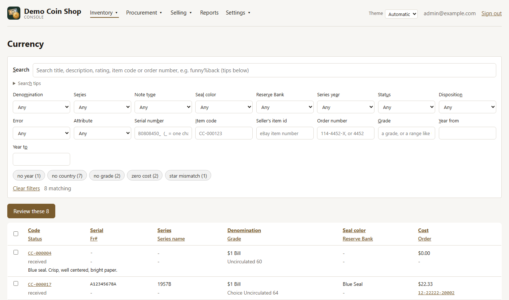

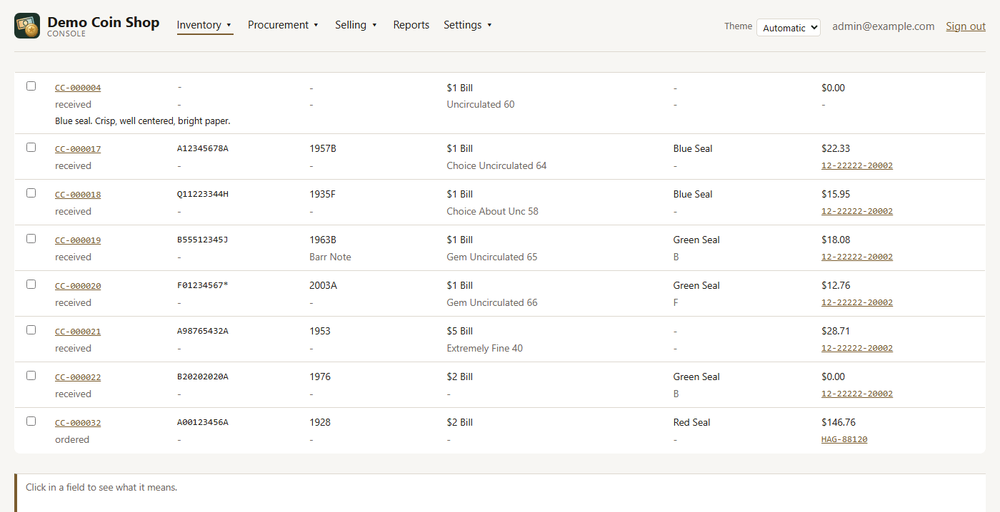

- **Search** matches a title, description, rating, item code or order number,
  and also the names of what an item is: `mercury` finds Winged Liberty Head
  dimes whose listing never says Mercury. **Search tips**, under the box, gives
  examples.
- **The dropdowns** narrow the result, and each lists only the values among the
  items the other filters found, with a count.
- **A column heading** sorts the table by that column. A second click reverses
  the order.
- **An item code** opens that item in the editor.

The search and filters, as the help band explains each one:

| Field | Shown | What it is |
|---|---|---|
| **Search** |  | Finds items whose title, description, rating, item code or purchase order number contain what you type, ignoring case, and items whose series, mint, strike, designation, note type or attribute is called that. Several words are one phrase, in that order. % stands for any run of characters and _ for exactly one. Press Enter or leave the box to search. |
| **Search tips** |  | Worked examples of the search box; click one to run it. |
| **Denomination** |  | The face value printed on the note or coin -- $1, $5, a half dollar. |
| **Series** |  | The one design this piece was struck or printed in, as collectors name it: Morgan Dollar, Walking Liberty Half Dollar, or for a note Funnyback. Each design is distinct, and an item has at most one. Price guides and population reports are organised by it, and for a coin it can decide the metal and weights. On a note it is not the series year printed on the face: in "SERIES 1935 A", 1935 is the series year. A private round or bar has no design series; say what it is with Bullion form. |
| **Kind** | Coins | What the item is: a coin, a banknote, bullion, a set, and so on. It decides which fields apply -- a note has no metal or strike type, a coin no serial number. |
| **Metal** | Coins | What it is struck in: silver, gold, copper, copper-nickel clad, and so on. With the fineness and weight, it decides the melt value. |
| **Strike type** | Coins | How the coin was made: a business strike, made for circulation and graded Mint State (MS), or a proof, struck with specially polished dies for collectors and graded PR. It decides whether a 65 reads MS65 or PR65. |
| **Mint** | Coins | The mint that struck the piece, listed by name. A government mint puts its mark on the coin -- P Philadelphia, D Denver, S San Francisco, O New Orleans, CC Carson City, W West Point -- though most older Philadelphia coins carry none; a refiner such as Valcambi strikes no mark. |
| **Country** | Coins | The country that issued it. |
| **Note type** | Currency | The kind of note, printed across the top of the face: Federal Reserve Note, Silver Certificate, United States Note, and so on. |
| **Seal color** | Currency | The color of the Treasury seal, right of center on the face: green on a Federal Reserve Note, blue on a Silver Certificate, red on a United States Note; brown, gold and yellow on some older and wartime issues. |
| **Reserve Bank** | Currency | The Federal Reserve Bank that issued the note: the letter in the black seal on the left of the face (A Boston to L San Francisco; B is New York). The same bank shows as the number printed four times around the face (2 for New York). |
| **Series year** | Currency | The year after the word SERIES on the face, near the signatures -- "SERIES 1963 A" is 1963. It is the year the design was adopted, not the year the note was printed: notes of one series are often printed for years afterwards. |
| **Status** |  | Shows only the items at this point in buying: ordered (bought, not yet arrived), received (in hand), canceled (the order was called off), returned (sent back to the seller), missing (paid for, never arrived) or unknown. Any shows every status. |
| **Disposition** |  | What has become of the item once it is yours: held, listed, sold, shipped, delivered, returned. Status says whether it has arrived; disposition says where it stands in selling. |
| **Error** |  | Only items with this printing or minting error recorded on them. The list is of the errors the matching items carry, each with how many. |
| **Attribute** |  | Only items carrying this attribute: Star Note, Radar, First Strike, CAC and the like. The list is of the attributes the matching items carry, each with how many. |
| **Serial number** |  | All or part of a serial, anywhere in it. _ stands for exactly one character, so B0808450_ finds a run of consecutive notes; % for any run. On coins it is a bar's, round's or Goldback's own serial. |
| **Item code** |  | All or part of an item code: CC-006140, or 6140. |
| **Seller's item id** |  | All or part of the seller's id for the listing an item was bought from -- eBay's item number. Every piece split from one listing keeps it, so one number can find several items. |
| **Order number** |  | The seller's order or invoice number, from the receipt, email or packing slip. When searching, part of it is enough: "4452" finds order 114-4452-X, upper or lower case alike, and the dashes may be left out: "1144452X" finds it too. |
| **Grade** |  | A grade or a range of grades: 65 is exactly 65, 64+ exactly 64+, and 55% both 55 and 55+. PR69 names the strike too. BU is 60-62, BU+ 63-64, BU++ 65-66 and BU% all three. Coins and notes each use their own scale. |
| **Year from** |  | Only items dated this year or later. Leave blank for no lower limit. |
| **Year to** |  | Only items dated this year or earlier. Leave blank for no upper limit. |
| **A data-quality chip, such as no year (12)** |  | Ready-made lists of items needing attention, with how many each finds: no grade, no cost, and so on. Click one to show only those items; click it again to go back. Only checks with something to find are shown. |
| **Clear filters** |  | Empties the search box and every filter, showing everything in this view. |
| **Select this page (table heading)** |  | Ticks every item on this page -- this page only, not every match -- to act on them together: edit them in bulk, offer them for sale or group them into a lot. |
| **A row's tick box** |  | Tick items to act on them together: edit them in bulk, offer them for sale or group them into a lot. |

The rounded chips are data-quality checks, each with the number of items it
finds. Click one to list those items, and click it again to go back. This one
shows the items with no grade:

Tick rows to get the bulk bar, which sets what the selected items share, offers
them for sale or groups them into a sales lot:

The bulk bar's fields:

| Field | Shown | What it is |
|---|---|---|
| **Field to change** | Year and Metal on Coins only | Which one field to set on every selected item. The value beside it replaces what each item holds. All of them are changed or none: if any one is refused, nothing is. Grade is typed as on an item (65, MS65); country, denomination and metal are typed as their code. |
| **New value: Year** | Coins | The date struck on the coin. |
| **New value: Grade** |  | The condition, on the 1 to 70 scale graders use -- 70 is perfect. Coins and notes each have their own scale in this list. |
| **New value: Country** |  | As under *Search and filters (Coins and Currency)*. |
| **New value: Denomination** |  | As under *Search and filters (Coins and Currency)*. |
| **New value: Metal** | Coins | As under *Search and filters (Coins and Currency)*. |
| **New value: Storage location** |  | Where the piece is kept -- a safe, a bank box, home. Optional: choose it when it is known, and change it whenever the piece moves; every move is kept in the item's history. It never shows to a buyer. |
| **Group into lot: Lot** |  | Where the selected items go: a new lot, or one still being assembled. A lot is offered and sold as one thing. Grouping changes nothing else about an item, which stays in stock. |
| **Group into lot: Title** | a new lot | What the new lot is called: the Lots page lists it by this, and its offer starts from it. |

A search that finds a single item opens it in the editor straight away. Once
closed, it stays closed until the search changes.

**Review these** walks through the current result one item at a time, in the
editor. The list is frozen when you start, so fixing an item does not skip the
next one. **Leave review** or Escape returns to the list.

#### The item editor

Everything recorded about one item is here. Changes are held until **Save**.

- A value marked *suggested* was worked out from the facts, and typing over it
  makes it yours, so nothing fills that field again.
- **Suggest description** writes a description from what the form shows.
- **Photographs** adds pictures from a file or a web address, and sets which is
  primary.
- **Offers** shows where the item has been offered, and **History** shows who
  changed what and when.
- A banner warns when the item is for sale, because buyers see a change at once.
  Tick **Change it anyway** to save.

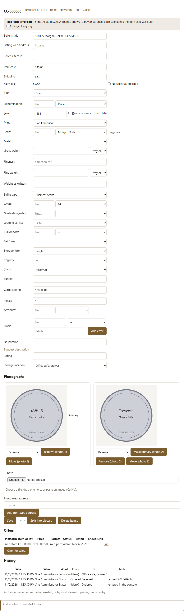

A note has its own fields, such as series, serial, plates, seal, signatures and
district, and most of them follow from the series and serial:

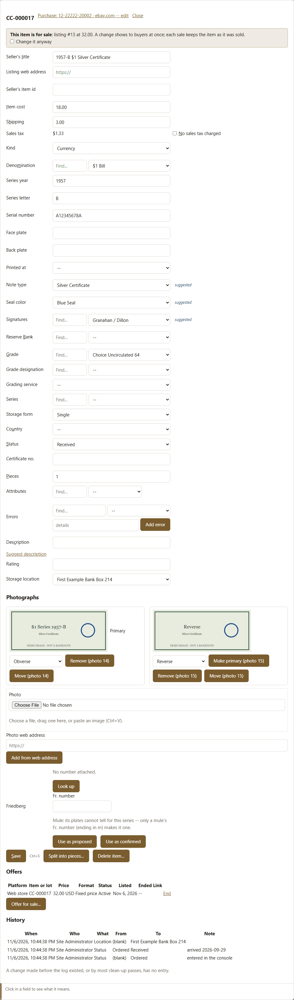

The editor's fields, top to bottom. Which appear depends on the kind: a note has its own, and a coin, bullion, a set, a medal or a token share the rest, in an order suited to each.

| Field | Shown | What it is |
|---|---|---|
| **Purchase (link in the heading)** | the item is on a purchase | The purchase this item was bought on: its order number and vendor. The order number belongs to the purchase, not the item: this opens the purchase in a new tab, where Edit details changes its number, date, web address, seller or notes. |
| **Seller's title** |  | What the seller called it, as written in the listing or invoice -- kept as the seller's words. The title a buyer sees is set when it is offered for sale. |
| **Listing web address** |  | The web address of the listing this was bought from -- the eBay, HiBid or Whatnot page. Pieces entered one after another keep it, since a lot comes from one listing. Shown as "Listing" in the item editor, which opens it in a new tab. |
| **Seller's item id** |  | The seller's own number for the listing this was bought from -- eBay's item number. Every piece split from one listing keeps it, so a lot stays traceable. Where it is an eBay item number, the editor's heading shows it as a link that opens the listing on eBay in a new tab. |
| **Item cost** |  | What was paid for this item, in dollars, before shipping and tax. On an order of several items, the price of this one. |
| **Shipping** |  | This item's share of the shipping charged on the order, in dollars. |
| **No sales tax charged** |  | Tick when the seller charged no sales tax at all -- the items are stamped with a rate of zero rather than the default. |
| **Kind** |  | As under *Search and filters (Coins and Currency)*. |
| **Denomination** |  | As under *Search and filters (Coins and Currency)*. |
| **Year (Year from when a range)** | not a note | The date on the coin. For a set, or a coin dated only to an era, tick "Range of years" and give the first and last year. |
| **Range of years** | not a note | Tick when the item covers several years -- a set, a roll, a lot of mixed dates -- to give a first and last year instead of one. |
| **No date** | not a note | Tick for a piece that carries no date at all -- a gold bar, an undated round. Different from leaving the year empty, which means not recorded yet: a piece with no date is not listed under "No year recorded". |
| **Year to** | Range of years ticked | The last year of the range. |
| **Mint** | not a note | As under *Search and filters (Coins and Currency)*. |
| **Series** |  | As under *Search and filters (Coins and Currency)*. |
| **Metal** | not a note | As under *Search and filters (Coins and Currency)*. |
| **Gross weight** | not a note | What one piece weighs, all of it, in troy ounces or grams -- pick the unit beside the box; it is kept in troy ounces. For several pieces, the weight of one: Pieces multiplies it. |
| **Fineness** | not a note | How much of the piece is the metal, as a fraction of 1: 0.999 for fine silver, 0.925 for sterling, 0.9 for 90% coin silver, 0.9167 for 22 karat. |
| **Fine weight** | not a note | The metal in one piece: what the melt value and the precious-metal report count. Leave it empty and it is worked out as gross weight times fineness; type it when it is what is known -- a one-ounce gold coin holds 1 troy ounce of gold and weighs more. |
| **Weight as written** | not a note | The weight in the words it came with, where a number does not say it all: "1 oz each", "1/2 Kilo". |
| **Series year** | a note | As under *Search and filters (Coins and Currency)*. |
| **Series letter** | a note | The letter after the series year -- the A in "SERIES 1963 A". It marks a later printing of the same series, usually because a new Treasurer or Secretary signed it. Leave it blank when the series has no letter, as SERIES 1995 does. It is not the letter in the seal: that is the Reserve Bank. If no note of that value was issued in that series, Receiving says so and lists the series that were. |
| **Serial number** | a note | The number printed twice on the face, with a letter before and after. On most Federal Reserve Notes the first letter is the Reserve Bank (B for New York); on $5 and higher from Series 1996 the first letter marks the series and the second the bank. A star in place of the last letter marks a replacement note. |
| **Face plate** | a note | The small plate number on the front, beside the check letter: a letter and digits (E82), or digits alone on older notes (153). A note printed in Fort Worth has FW before it (FW E82) -- that is what sets Printed at. With the back plate, it is how a mule is found. |
| **Back plate** | a note | The plate number printed on the back, digits only (1234). A face and back plate from different eras make a mule; the Friedberg web search asks about both and answers with an m suffix when it is one. |
| **Printed at** | a note | Where the note was printed: Washington, DC or Fort Worth, TX. Read from the face plate when there is one (FW before it is Fort Worth); choose it here only for a note whose face plate is not recorded. It tells some Friedberg numbers apart: the two printings of one series and denomination can each have a number of their own. |
| **Note type** | a note | As under *Search and filters (Coins and Currency)*. |
| **Seal color** | a note | As under *Search and filters (Coins and Currency)*. |
| **Signatures** | a note | The two signatures printed on the face: the Treasurer of the United States on the left, the Secretary of the Treasury on the right. Each series letter usually has its own pair. |
| **Reserve Bank** | a note | As under *Search and filters (Coins and Currency)*. |
| **Strike type** | not a note | As under *Search and filters (Coins and Currency)*. |
| **Grade** |  | As under *The bulk bar*. |
| **Grade designation** |  | A qualifier the grader adds to the grade, such as DCAM (Deep Cameo) on a proof, RD (Red) on copper, or EPQ (Exceptional Paper Quality) on a note. Only the ones that fit the item's kind are offered. |
| **Grading service** |  | The company that graded and sealed it in a holder ("slab") -- PCGS, NGC, PMG and others. Leave blank for an ungraded ("raw") item. |
| **Bullion form** | not a note | What shape a piece of bullion takes: bar, round and so on. A bar or a round has no face value, so it is recorded here and Denomination is left blank. A new bullion item saved with no form is a Round, shown as filled by a rule; choose its real form here when you know it. A value that is missing can be added here by its name. |
| **Set form** | not a note | What kind of set this is: proof set, mint set, mixed sets and so on. Leave Denomination blank for a set of several face values -- a denomination is one face value. A value that is missing can be added here by its name. |
| **Storage form** |  | How the pieces are packed: single, roll, tube, strap and so on. Choosing one with a usual count fills Pieces with it -- 50 for a roll -- unless Pieces already holds a count of its own; change Pieces when this one holds more or fewer. |
| **Country** |  | As under *Search and filters (Coins and Currency)*. |
| **Status** |  | Where the item stands in buying: ordered (bought, not yet arrived), received (in hand), canceled (the order was called off), returned (sent back to the seller), missing (paid for, never arrived) or unknown. Receiving moves an item forward; this is where a status recorded in error is put back, and the change is kept in the item's history. Whether it is held, listed or sold is a separate question. |
| **Variety** | not a note | A die variety or other variant within the date and mint -- a doubled die, an overdate -- as the seller or grader names it. |
| **Serial number** | bullion | The number stamped or printed on this bar, round or Goldback, exactly as it reads, letters and leading zeros included. It tells this piece from every other of its kind, so it is what to give the police or an insurer if the piece is stolen. |
| **Certificate no.** |  | The certification number printed on the holder's label, used to look it up on the grader's site. Separate several with commas. A number added here is recorded as graded by the grading service above. |
| **Pieces** |  | How many pieces this one entry stands for: 1 for a single coin or note, more for a roll, a set or a lot bought as one. Split into pieces, below, makes each piece an item of its own. |
| **Attributes** |  | What makes this piece special beyond its grade: Star Note, Radar, First Strike, CAC and the like. Type in Find to narrow the list, choose one to add it, and use its x to remove it. Only those that fit the item's kind are offered. |
| **Errors** |  | Printing or minting errors recorded on the item, each with a note of where and how -- an offset's direction, a miscut's size. |
| **An error's details** |  | A note on this error: where and how -- "Back to Front", "left margin", "3 o'clock, 4mm". Clearing it removes only the note; to remove the error, use its Remove button. |
| **Description** |  | Anything else worth keeping about this item: the seller's full description, notes on condition or where it came from. |
| **Rating** |  | Your own words about the piece: its condition, grade and what makes it special. Search reads it, and so do the rules that work out a design series or a note's class, so a word that is wrong here should be corrected here. A buyer never sees it. |
| **Storage location** |  | As under *The bulk bar*. |
| **Photographs** |  | The item's pictures. Choose a file, drag one onto the box, or paste one with Ctrl+V to add it; say what each one shows (obverse, reverse, slab ...), make one the primary -- the one the shop shows first -- remove one, or move one to another item by its code. Nothing is filed or changed until the form's Save. |
| **Move to item (a photograph)** | moving a photograph | The code of the item this photograph belongs on instead, as CC-000123. Type it and press Find or Enter, then choose the match. The move is made when the item is saved. |
| **Change it anyway** | the item is for sale | The item is offered for sale, as the notice above says. Tick this to make the change all the same; a buyer sees it at once. A sale already made keeps the item as it was sold. |
| **Fr. number** | a note | The Friedberg catalog number for this type of note, in the form 9901-B: a number for the type and, on a Federal Reserve Note, the Reserve Bank letter. Read it off the slab or holder or a reference, or copy it from a match in your own catalog. |
| **Web press (Friedberg lookup)** | a note | Printed on the Bureau of Engraving and Printing's experimental web press, from a roll of paper, instead of the usual sheet-fed press. Only some $1 notes of series 1988-A, 1993 and 1995 were. The two printings have different Friedberg numbers. Leave it as not known unless you can tell. |
| **Star note (Friedberg lookup)** | a note | A replacement note: its serial carries a star in place of a letter. A star note has its own Friedberg number, ending in * (3007-B*), so the lookup offers only the kind this is. Filled from the note's serial; Not known offers both. |
| **Mule (Friedberg lookup)** | a note | A note printed from a face plate and a back plate made for different series. A mule has its own Friedberg number, with an m (3007-Em), so Yes offers only mules and No leaves them out. Yes when the note carries the Mule attribute; Not known offers both. |
| **Delete item...** |  | Removes an item that should never have been entered -- one purchase recorded twice. It asks first. An item with pieces split from it, one that has ever been offered, or one in a sales lot cannot be deleted, and the reason is shown. |

**Split into pieces...** turns a lot bought as one item into one item per
piece, each with its share of the cost. It cannot be undone.

The split dialog's fields:

| Field | Shown | What it is |
|---|---|---|
| **Pieces** |  | How many items the lot becomes: a row each, below. It starts at the Pieces the lot records. |
| **Divide the cost** |  | Equally gives every item the same share -- nine proof sets, a tube of rounds. By value divides in proportion to a value you give each piece -- face, melt or a price guide -- so a half dollar does not carry the cost of a cent. Shipping is divided the same way. |
| **Description (each row)** |  | What this piece is, in your words: "1980 US Proof Set". Left as it is, the piece keeps the lot's description. The seller's title stays the lot's. |
| **Year (each row)** | not a note | This piece's year. Blank keeps the lot's. |
| **Items (each row)** |  | How many items this row holds, usually 1. A row of 3 takes three shares of the cost and stays one item of 3 pieces. |
| **Value of one (each row)** | dividing by value | What one item of this row is worth, on whatever basis you choose -- the same basis for every row. Only the proportions matter: it divides the lot's cost and is kept on the piece. |

#### Photos

Photographs not yet filed against an item wait here, usually from a bulk import
whose file names could not be matched. Enter an item code, use **Find** to check
it, then **Link**.

Its one field:

| Field | What it is |
|---|---|
| **Item code (each photograph)** | The code of the item this photograph shows, as CC-000123. Type it and press Find or Enter, choose the match, then Link. |

#### Order lookup

Finds a purchase from what you remember of it: part of an order number, a vendor
or a seller, a range of dates, or whether anything is still to arrive. The page
says how many purchases match and what they cost together, and an order number
opens that purchase.

Its fields:

| Field | What it is |
|---|---|
| **Order number, vendor or seller** | Type any part of an order number, a vendor name or a seller name: the list narrows to the purchases that have it. A purchase number (3974 or #3974) finds that one purchase. Capitals do not matter. |
| **Ordered from** | The earliest order date to list, that day included. Leave it empty for no earliest date. A purchase with no order date is listed only while both date boxes are empty. |
| **Ordered to** | The latest order date to list, that day included. Leave it empty for no latest date. |
| **Only purchases with items not yet received** | Tick to list only the purchases still waiting on something: an item marked Ordered, or one marked Missing, which may yet turn up. Untick to list every purchase again. |

### Procurement

#### Purchases

Every item enters the system on a purchase, so its cost always traces to an
order. Start a new one with a vendor. The order number, date, web address, seller
and notes are optional, and a blank number is issued as `Order-0001` and up.

To add to a purchase already recorded, choose **Add to an existing purchase**
and pick it from the list:

An open purchase lists its items as Coins and Currency do -- year, mint,
series, grade and the description for a coin, serial, series and seal for a
note -- in item-code order until a column heading is clicked to sort by it,
with a total under them -- item cost,
shipping, tax and what was paid in all, the figure Order lookup shows as its
Cost -- and takes more under **New item**. A kind and a
title make the item and open it in the editor. **Add another like** starts the
next one from what items on the same order usually share. When two or more items
are still ordered, **Receive all N still ordered** under the table receives the
whole parcel here, in the same dialog as Receiving's. **Receive these** goes to
Receiving for this purchase, to receive line by line.

The fields of a purchase and of its New item form:

| Field | Shown | What it is |
|---|---|---|
| **Start a new purchase / Add to an existing purchase** |  | Start a new purchase for a new order; add to an existing one when more items from an order already entered need recording. Every item belongs to exactly one purchase. |
| **Vendor** | a new purchase | Who sold it: the website, auction house, dealer or person. Add a new one if it isn't listed. |
| **Order number** | a new purchase | As under *Search and filters (Coins and Currency)*. |
| **Order date** | a new purchase | The date of the purchase -- when the order was placed or the auction won -- not the date it arrived. Arrival is recorded in Receiving. |
| **Web address** | a new purchase | A link to the listing, auction lot or invoice, so the purchase can be checked later. It appears as "Vendor page" on the order. |
| **Seller** | a new purchase | Who sold it on the marketplace the vendor names -- the eBay seller, the Whatnot shop. Pick one, type their store address to find or add them, or "+ Add a seller..." for a new one with a name and store link -- a web address, or their email address -- and, if wanted, the contact behind it: name, email and phone (country code first). Shown by name, linked to their store, on the order and in Receiving; the contact is kept in Settings > Lists > Sellers. |
| **Notes** | a new purchase | Anything about the purchase as a whole, rather than one item on it. |
| **Filter** | an existing purchase | Type part of an order number, a vendor name or a seller name to shorten the list, or a purchase number (3974 or #3974) to find that one purchase. |
| **Only purchases with items not yet received** | an existing purchase | As under *Order lookup*. |
| **Edit details** | a purchase open | Change this purchase's order number, date, web address, seller or notes. Clear the order number to give it the next generated one (Order-0001, Order-0002, ...). |
| **Tax rate** | a purchase open | The sales tax rate charged on this purchase, as a decimal: 0.0635 for 6.35%. Leave it blank to use the configured default. Every item entered below is stamped with it. |
| **No sales tax charged** | a purchase open | As under *The item editor*. |
| **Tax on shipping** | a purchase open | Whether the tax was charged on shipping as well as on the price. States differ; "As configured" uses the default setting. |
| **New item: Kind** | a purchase open | As under *Search and filters (Coins and Currency)*. |
| **New item: Storage form** | a purchase open | As under *The item editor*. |
| **New item: Seller's title** | a purchase open | As under *The item editor*. |
| **Add item** | a purchase open | Makes the item on this purchase and opens it in the editor, where its details, photographs and description are entered. Close the editor without saving and the item is not kept. |
| **Add another like** | an item on it opened | Starts the next piece from what it shares with the item the button names: the one you last opened on this purchase, or the latest when none was opened. Copied: kind, title, cost, shipping, listing and its item id, status, where it is kept, storage form and pieces, country, denomination, series, set form, grade, grading service, and a note's series, seal, district, class and signatures or a coin's metal, mint, bullion form and strike, and a set's designation, and its sales tax: "No sales tax charged" ticked on it is ticked on the next. A loose piece's designation, serial, certificate, years and description are entered for each piece. |

#### Receive

Records what actually arrived and where it is kept. Only a received item can be
offered for sale. A parcel is found by its order number, its vendor or seller,
or what is in it, and by default only what has not arrived yet. Searched by an
order number, everything still to come on that purchase is listed, with
**Receive all** above it for the whole parcel:

The search's fields:

| Field | Shown | What it is |
|---|---|---|
| **Search for: Any, Coins or Currency** |  | Any: coins and notes together -- one parcel can hold both. Coins: adds a search by year and mint. Currency: adds a search by series year. The serial number box is there for all three: a note's serial, or a bar's, round's or Goldback's. |
| **Order number** |  | As under *Search and filters (Coins and Currency)*. |
| **Vendor** |  | Only items bought from this vendor -- the website, auction house or dealer the purchase was made at. Part of the name is enough, upper or lower case alike: "apmex" finds apmex.com. |
| **Seller** |  | Only items from this seller -- the account or shop on the vendor's marketplace, such as an eBay seller. Part of the name is enough, upper or lower case alike. |
| **Status** |  | Where the item stands in buying: ordered (bought, not yet arrived), received (in hand), canceled (the order was called off), returned (sent back to the seller), missing (paid for, never arrived) or unknown. "Not yet arrived" means ordered or missing -- a missing parcel sometimes turns up. "Any status" shows everything, which is how to see a whole order including what already came. |
| **Denomination** |  | As under *Search and filters (Coins and Currency)*. |
| **Serial number** |  | As under *Search and filters (Coins and Currency)*. |
| **Ordered since** |  | Only items from orders placed on this date or later -- the order date, not the day it arrives. With no order number to hand, a date a little before the order, a denomination and part of the serial find the item. |
| **Year** | Coins | As under *The bulk bar*. |
| **Mint** | Coins | As under *Search and filters (Coins and Currency)*. |
| **Series year** | Currency | As under *Search and filters (Coins and Currency)*. |

**Receive these** on a purchase opens it already searched for that order:

Clicking a line opens it. Confirm the facts that identify the piece, then give
the arrival date, storage location, any note and photographs, and choose one of
**Receive**, **Missing**, **Returned** or **Canceled**. The date and location
carry to the next item, so a parcel going into one box is picked once.

The fields of the receipt for one item. The first group confirms what the piece is; **Receive all** shows only Arrived, Storage location, Note and Photo:

| Field | Shown | What it is |
|---|---|---|
| **Year** | not a note | As under *The item editor*. |
| **Mint** | not a note | As under *Search and filters (Coins and Currency)*. |
| **Series year** | a note | As under *Search and filters (Coins and Currency)*. |
| **Series letter** | a note | As under *The item editor*. |
| **Denomination** |  | As under *Search and filters (Coins and Currency)*. |
| **Serial number** | a note | As under *The item editor*. |
| **Face plate** | a note | As under *The item editor*. |
| **Back plate** | a note | As under *The item editor*. |
| **Fr. number** | a note | As under *The item editor*. |
| **Errors** |  | As under *The item editor*. |
| **Arrived** |  | The day the parcel came, today unless you change it. Recorded only when the item is received; the next item you open starts with the same day, since one parcel usually holds several. |
| **Storage location** |  | As under *The bulk bar*. |
| **Note** |  | Anything worth saying about this piece as it arrived: "corner bent", "wrong coin sent". It is kept with the status change in the item's history, and is not carried to the next item, since it describes this one. |
| **Photo** | one item | Pictures of the piece as it arrived: choose files, drag them onto the box, or paste one with Ctrl+V. They are added to the item after the receipt is recorded, and only when one item is being received. |

When the whole parcel came, **Receive all** records every line still ordered in
one step. It is offered on the purchase itself, on a purchase opened with **Receive these**, and after
a search whose items are all on one purchase -- type its order number and
press **Find** -- where it names that order ("Receive all 3 still ordered on
49573"). Items from two purchases offer nothing; pick a line, or open the
purchase.

### Selling

An item is offered in one place at a time, so it can never be sold twice.

#### Listings

Every offer, in the web store and elsewhere, with its price, cost and margin.
**Edit** changes the wording or price and **End** withdraws the offer.
**Record sale...** enters a sale made on another platform.

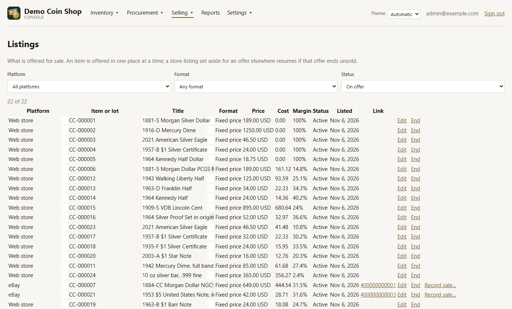

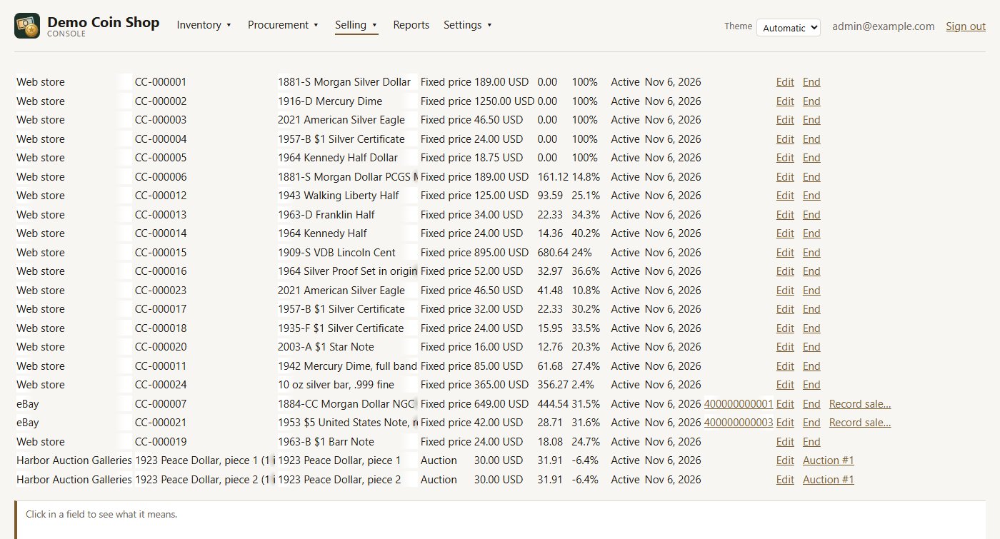

The filters above the list, and the fields of **Edit**:

| Field | Shown | What it is |
|---|---|---|
| **Platform** | the filters | Shows only the offers on one platform, or on all of them. |
| **Format** | the filters | Shows only fixed-price offers, or only auction listings, or both. |
| **Status** | the filters | On offer shows what is active or paused: a paused store listing is one set aside while the item is offered elsewhere. Active, Paused and Ended show only that status; All, including ended, shows every offer ever made. |
| **Price** | Edit | What it is offered for, as an amount like 189.00. A change shows at once where the offer is listed in the web store; on another platform, change it there too. |
| **Title** | Edit | What a buyer sees it called. |
| **Description** | Edit | The wording that goes with the title. It may be left empty. |
| **Listing number** | Edit | The platform's own number for this listing, where it has one: the eBay item number, the lot number on an auction site. Leave it empty if there is none. |

An offer is made with **Offer for sale...**, from the Coins or Currency bulk bar
or the item editor. Choose a platform and format, then give each item a price,
title and description. The dialog shows cost, estimated fees, net and margin as
you type, and **Fill blank prices** prices the empty rows for the margin you ask
for.

The offer dialog's fields:

| Field | What it is |
|---|---|
| **Platform** | Where these are offered: the web store, or an outside platform. One platform for everything in this window. An item is offered in one place at a time: offering one that is in the web store pauses its store listing: it comes back if this offer ends unsold, and ends with it if the item sells. |
| **Format** | Fixed price, or Auction for a listing sold by bidding. The bidding is run where it is listed, never here. One format for everything in this window. |
| **Margin after fees, %** | The share of the price to be left once the platform's recorded fees and the cost are taken out, as a percentage. Fill blank prices sets each empty price to the lowest that leaves it. A price already typed is not touched, and one with no cost recorded is left blank. |
| **Price (each row)** | What it is offered for. Beside it are the platform's recorded fees on that price, what is left after them, and the margin over cost. |
| **Title (each row)** | What a buyer sees it called. An item starts with a title written from its record, not the seller's wording from the purchase; a lot starts with its own. Change it here before offering. |
| **Description (each row)** | The wording that goes with the title. It starts as the description on record, and may be left empty. |
| **Listing number (each row)** | The platform's own number for this listing, where it has one. Leave it empty if there is none yet. |

Recording an outside sale takes the price, buyer, the platform's order number
and the fees it actually charged, and ends the listing:

Its fields:

| Field | What it is |
|---|---|
| **Sale price** | What the buyer paid for it, as an amount like 189.00, before the platform's fees: the fees go in the table below, and the net is worked out from both. |
| **Buyer username** | The name the platform shows for the buyer: their eBay username, their Whatnot handle. A buyer already recorded on this platform under that name, in any capitals, is the same customer; a new name becomes a new one. Leave it blank if the platform does not name the buyer. |
| **Order number** | The platform's own order or transaction number for this sale, to find it in their records. It is kept with the order. |
| **Fees (each kind)** | What the platform actually charged on this sale, one line per kind of fee, from its statement or invoice. Leave a kind blank if it was not charged. These are what the sale records; the default fees on the Platforms page are only for estimating a price. |

#### Lots

A sales lot is a group of items sold as one thing. The items stay individually
owned, costed and reportable. Select them on Coins or Currency and choose **Group
into lot...**, and they appear here to be worded and offered. Offering freezes
the lot. Ending the offer dissolves it, and **Re-offer as a lot** starts it again.

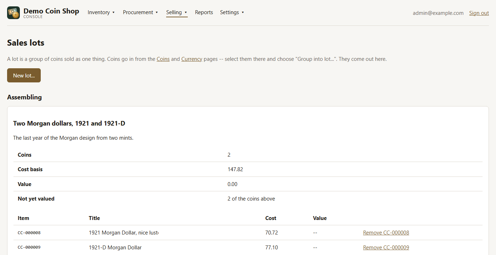

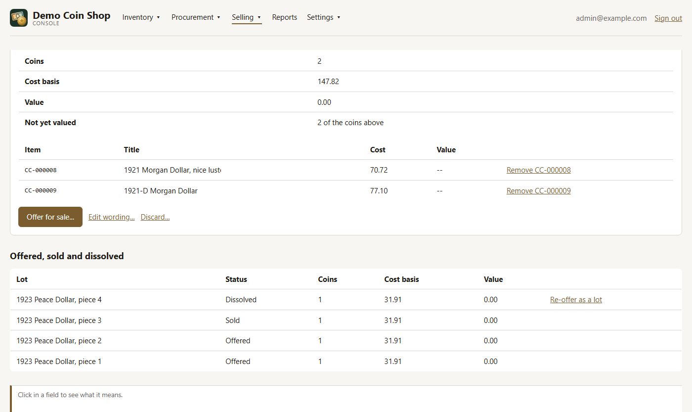

**New lot...** and **Edit wording...** ask for the lot's wording:

| Field | What it is |
|---|---|
| **Title** | What the lot is called: the Lots page lists it by this, and its offer starts from it. |
| **Description** | The wording for the lot as a whole -- what it holds, why it goes together. Its offer starts from it, and it may be left empty. |

#### Auctions

The platform runs the bidding, and this page runs everything around it. An
auction moves from draft to scheduled, optionally consigned at an auction house,
then closed and settled.

While it is a draft, **Add lot...** puts in a sales lot or a single item, and lot
numbers and reserves can be edited:

The fields of **New auction...**, **Add lot...**, the lot table, **Mark consigned...** and **Cancel...**:

| Field | Shown | What it is |
|---|---|---|
| **Platform** | New auction | Where the auction is run: an auction house, a live-auction site, or a marketplace for a single timed auction. The web store runs no auction, and a retired platform is not offered. Platforms are added on the Platforms page. |
| **Title** | New auction | The auction's name, as the platform gives it. The list of auctions and every question about this one name it by this. |
| **Sale number** | New auction | The house's or platform's own number for the sale, to find it in their catalog and statements. Leave it empty if there is none yet. |
| **Starts** | New auction | When bidding opens, written year-month-day hour:minute with the hour out of 24: 2026-11-20 18:00. It may be left empty. It is a record only: the platform opens and closes the bidding, never this page. |
| **Ends** | New auction | When bidding closes, written as Starts is. It may be left empty. Close the auction here once the sale has actually happened. |
| **Notes** | New auction | Anything about the auction as a whole, kept with it here. |
| **Single item / Assembled lot** | Add lot | What this lot sells: one item on its own, found by its code, or a sales lot still being assembled -- one grouped on Coins or Currency with Group into lot. The lot number, reserve and starting bid are the same either way. |
| **Lot number** | Add lot, the lot table | The number the house or platform gives this lot in the sale: 1042, or 12A. Each lot in an auction has its own. It can be changed until the auction closes. |
| **Item code** | Add lot, a single item | The code on the item, as CC-000123, to sell it on its own as a lot of one. It is looked up when the lot is added; a code no coin or note has is refused. |
| **Lot** | Add lot, an assembled lot | A sales lot still being assembled, to sell all its items together. A lot already offered somewhere is not listed. |
| **Reserve** | Add lot, the lot table | The lowest price agreed for this lot, if there is one. It is kept here as a record and shown when settling; the platform holds the sale to it. It can be changed until the auction closes. |
| **Starting bid** | Add lot | Where bidding opens, if the platform asks for one. It may be left empty. |
| **Consigned on** | Mark consigned, an auction house | The day the items went to the auction house. They are recorded as at the house from then on, until they are sold or come back. |
| **Return items to** | Cancel or Remove, once consigned | Where the items are put away now they are back from the auction house. Asked for because the auction was consigned: the items left the premises, and something must say where they are now. |

Once closed, each lot's result, hammer price and buyer are entered, and **Settle**
makes one order per buyer. Unsold lots come back:

The settlement grid, shown once the auction is closed:

| Field | What it is |
|---|---|
| **Result (each lot)** | How the lot ended: Sold, Unsold, or Withdrawn before the sale. A lot left on Choose a result stops the settlement, and its row says so. Unsold and withdrawn items go back on hand. |
| **Hammer price (each lot)** | The winning bid, as an amount like 189.00, before the buyer's premium and the house's fees. Only for a lot marked Sold. |
| **Buyer (each lot)** | The winning bidder as the platform names them. Lots with the same buyer, in any capitals, become one order. At an auction house a blank buyer is its undisclosed buyer, for a house that does not say who bought. Only for a lot marked Sold. |
| **Fees (each buyer)** | What the platform charged on this buyer's order, one box per kind of fee, from its statement. Leave a kind blank if it was not charged. Each buyer of a sold lot has a table of their own. |
| **Return unsold and withdrawn items to** | Where the lots that did not sell are put away when they come back from the house. Needed before settling when the auction was consigned and any lot is unsold or withdrawn. |

#### Sales

Every order, whatever its source. Change the status from the order's row, through
pending, paid, packed, shipped and delivered, or canceled and refunded. **Edit**
revises an order still pending or paid. No money moves here: orders are settled
outside the system.

**New order** places an order on a customer's behalf, for a sale in person or by
telephone:

The fields of the Sales page and of an order, new or edited:

| Field | Shown | What it is |
|---|---|---|
| **Show** | the list | Shows only the orders in one status, or every order. |
| **Status (each row)** | the list | Where the order stands: Pending, Paid, Packed, Shipped, Delivered, or Canceled or Refunded. Choosing one saves it at once. Canceling or refunding an order not yet shipped puts its items back on sale; a canceled order cannot be moved on. A status the order cannot take says why when chosen. |
| **Find customer** | an order | Type part of a name or email address to shorten the Customer list beside it. |
| **Customer** | an order | Who the order is for: a customer already on record, or a shop account that has not ordered yet ("account, no orders yet"), which becomes a customer when the order is saved. |
| **Quantity (each line)** | an order | How many of this listing the order takes, no more than are available. Saving moves the stock by the difference. |
| **Unit price (each line)** | an order | What the customer pays for each, as an amount like 189.00. It starts at the listing price, shown below the box when this differs. Changing the total of a paid order flags a payment adjustment. |
| **Find item** | an order | Words to find something in the web store that is in stock. Press Search, then Add beside the one wanted; it joins the order at its listing price. |
| **Notes** | an order | Anything about the order: how it was taken, what was agreed. |

**History** shows who placed and changed an order:

#### Platforms

Where items are sold, with each account's default fees. Those fees are only for
estimating a price. Nothing is shipped for them, so enter them from your own
account, with the date you read them.

The fields of **Add platform** and **Edit**:

| Field | Shown | What it is |
|---|---|---|
| **Name** |  | The platform as it is shown everywhere in the console: eBay, Whatnot, Heritage. |
| **Code** | adding | A short lower-case name the system keeps for the platform, as ebay or heritage. It is set when the platform is added and cannot be changed. |
| **Kind** | not the web store | How the platform sells: a marketplace (fixed-price listings, or a single timed auction), a live-auction site, or an auction house, which holds the items while they are consigned to it. A sale recorded from a marketplace or live auction starts as paid; one from an auction house as delivered, since the house ships it. |
| **Purchase source** |  | The vendor of the same name, where items are also bought there, so eBay is one partner whether buying or selling. Each vendor can be linked to one platform. Leave it as (none) if nothing is bought there. |
| **Account** |  | Your own username or seller id on the platform. |
| **Listing link** |  | The address of a listing on this platform, with {external_id} where the listing number goes: https://www.ebay.com/itm/{external_id}. An example link is shown below the form as you type. |
| **Commission %** |  | The platform's usual commission or final-value fee, as a percentage of the price: 13.25. Used only to estimate fees when pricing an offer. |
| **Processing %** |  | The payment-processing fee as a percentage of the price, if the platform charges one apart from its commission. Used only to estimate fees. |
| **Processing $ per sale** |  | A fixed amount charged on every sale, as 0.30. Used only to estimate fees. |
| **Fee $ per listing** |  | What it costs to list one item, whether it sells or not. Used only to estimate fees. |
| **Fees as of** |  | The day you read these fees from your account. Terms change, so the Platforms page shows the date beside them. |
| **Notes** |  | Anything about the platform or the account there. |
| **Retired** | editing, not the web store | Tick when nothing more will be sold here. A retired platform is not offered for new offers or auctions; everything sold there stays on record. A platform is never deleted. |

#### Spot prices

The price of a troy ounce of each metal, the fine ounces held and what they melt
for. Type a price and press **Record**. A price is never edited: a new one becomes
the current one, and the old one is kept.

Its one field:

| Field | What it is |
|---|---|
| **New price (each metal)** | What a troy ounce of this metal is quoted at today, in dollars: 31.50, or 0.2875 for copper. Record makes it the price from now on and keeps the one before; a price typed wrong is put right by recording another. |

### Reports

Reports answer questions over the whole collection, and only read. Choose one from
the list on the left, which is grouped as Collection, Data quality, Purchasing and
receiving, Selling and Money.

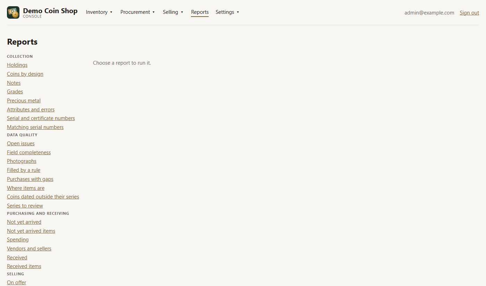

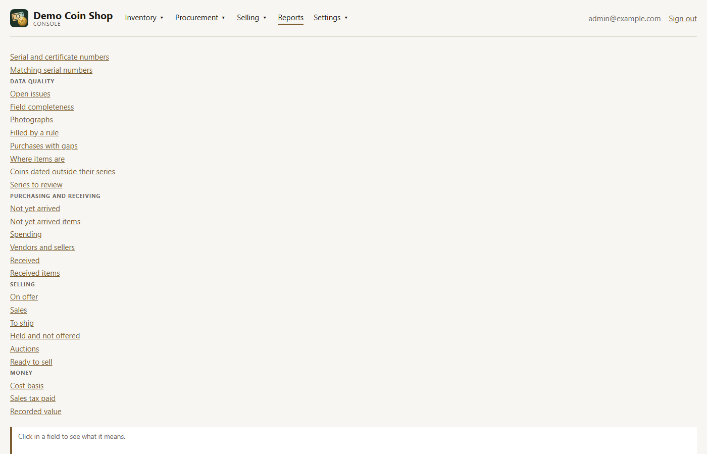

Set any parameters and press **Run**. **Export workbook** downloads the same result
as a spreadsheet, and **Print** prints it. A linked cell opens the items it counts.

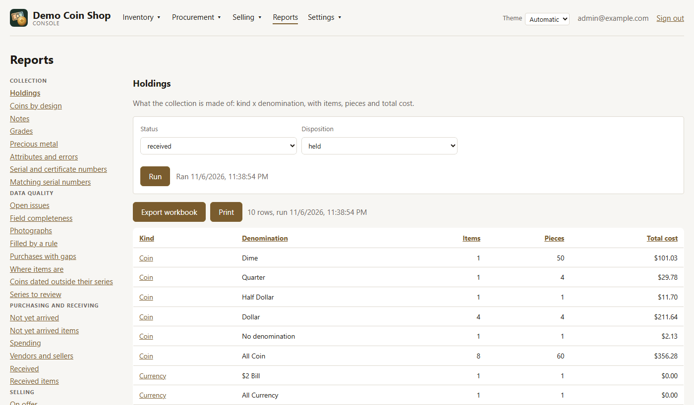

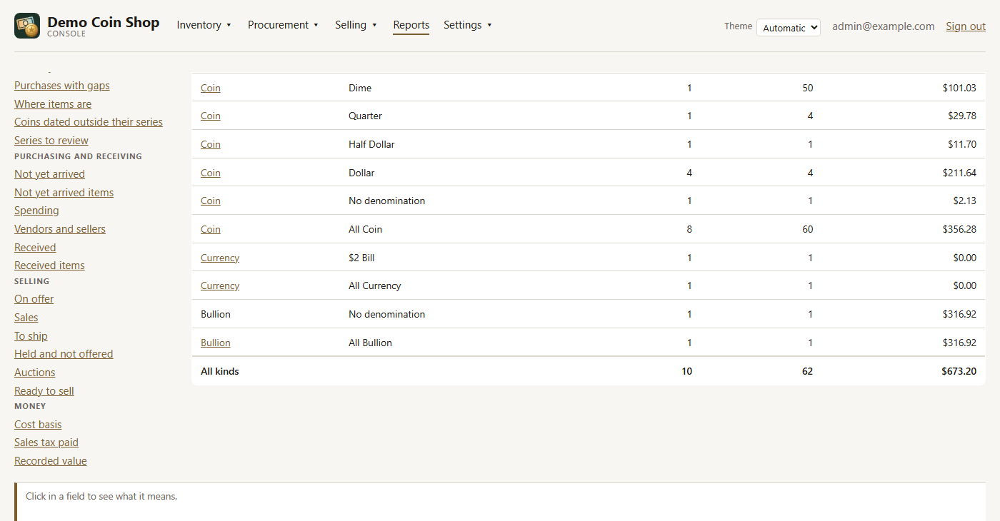

The parameters and controls, each report showing only its own:

| Field | Shown | What it is |
|---|---|---|
| **The list of reports** |  | Every report, by what it is about. Choose one to run it with its usual settings; the address then names it, so it can be bookmarked or reopened. |
| **Status** | reports of what is held | Which items to count by where they stand in buying: received (in hand) by default, or ordered (bought, not yet arrived), canceled (the order was called off), returned (sent back to the seller), missing (paid for, never arrived), unknown -- or all of them. |
| **Disposition** | reports of what is held | Which items to count by where they are in selling: held (still owned) by default, or listed, sold, shipped, delivered, returned by the buyer -- or all. |
| **Denomination** | Matching serial numbers | Whether matching notes must be of the same denomination: any, so a $1 and a $5 of one serial are a set, or must match. |
| **Letters** | Matching serial numbers | Whether the letters before and after the digits count: ignore, so B00003333A matches F00003333C on the digits alone, or must match. |
| **Star notes** | Matching serial numbers | Whether a star note matches the note without the star, the star standing where a letter would, or only another star note. |
| **Show** | Series to review | Which rows to list: all of them, or one kind of case only. |
| **From** | reports over a period | Counts from this date on. Left empty, there is no start -- everything up to To. |
| **To** | reports over a period | Counts up to this date. Left empty, there is no end -- everything from From on. |
| **Period** | Sales tax paid, Spending | How the dates are grouped into rows: by month, quarter or year, with a subtotal after each. Sales tax paid offers month or year only. |
| **Vendor** | Received items | One vendor's name exactly as the Received report shows it -- "No purchase" for items recorded with none -- or all for every vendor. |
| **Overdue after (days)** | Not yet arrived | How many days after its order date a purchase still waiting to arrive is marked Overdue. 21 unless changed. |
| **Run** |  | Runs the report with these settings and puts them in the address. The answer is from the database as it is now. |
| **Export workbook** | after a run | Saves this report, with the same settings, as an Excel workbook: its title and settings above the table, totals below, money as numbers. |
| **Print** | after a run | Prints the report as shown -- same rows, same order -- without the menu, this band or the settings. A wide report prints landscape. |
| **A column heading** | after a run | Click a column's name to sort by it, again to reverse, and a third time to return to the report's own order. |
| **A result row** | after a run | A linked value opens the page behind that row: the items it counts, or the purchase to receive. A linked item code opens that item to edit, over the report. A linked percentage opens the items missing that field. |

Some of the reports worth knowing first:

**Precious metal** gives ounces, cost and melt value at the latest spot price.

**Open issues** counts every data-quality check across coins and currency.

**Not yet arrived** lists purchases still waiting, oldest first, and marks the
overdue ones.

**Ready to sell** counts the items in hand and not offered, and how many have a
photograph, a grade or weight, a location and a cost.

**Sales** gives orders, gross, fees, net, cost basis and gain by month and platform.

### Settings

#### People

**Accounts** are who can sign in, as a manager or a customer. They are deactivated,
never deleted. **Customers** are who has bought, with their contact details and
addresses, including buyers recorded from other platforms.

The fields of both tabs:

| Field | Shown | What it is |
|---|---|---|
| **Email** | New account | The address the person signs in with. Two accounts cannot share one. |
| **Name** | New account | The person's name, shown with the account. |
| **Role** | New account, each account | What the account may do. A customer signs in to the shop only. A manager also signs in to this console and sees costs. The last manager cannot be made a customer. A change in the table is saved as it is made. |
| **Initial password** | New account | At least 8 characters: what the person first signs in with. |
| **New password** | Set password | At least 8 characters; press Set or Enter to save it. The account is signed out everywhere it was signed in, and signs in again with this. |
| **Name** | a customer being edited | The customer as the Sales page and their orders show them. |
| **Email** | a customer being edited | The customer's email address. |
| **Phone** | a customer being edited | Country code first, then the number: +1 for the United States, so +1 212 555 0100. It is kept whole, so it can be dialed from anywhere. |
| **Address line 1** | New address | The street address, or a post office box. |
| **Line 2** | New address | An apartment, suite or floor, if there is one. |
| **City** | New address | The city or town. |
| **State / region** | New address | The state, province or region, as NY. |
| **Postal code** | New address | The ZIP or postal code. |
| **Country** | New address | The two-letter country code: US, CA, GB. Saving adds this as the shipping address; the one before is retired and kept, not overwritten. |

#### Vocabularies

The values the pickers offer: grades, denominations, series, storage forms and the
rest. Choose a vocabulary to add a value or give one another name (an alias, which
search and the pickers then recognise). The ⋮ menu on a row renames, retires, merges
or edits it.

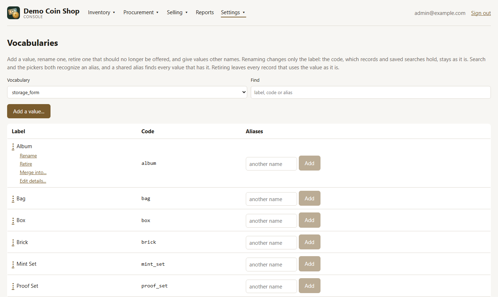

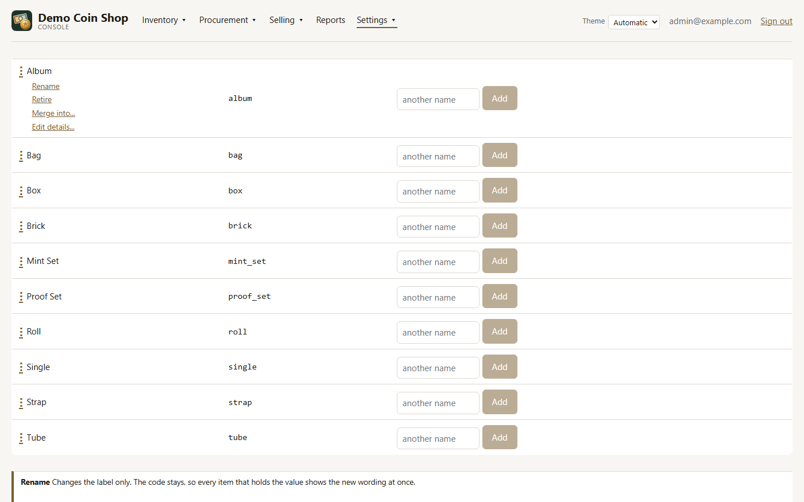

Its fields and a row's actions:

| Field | Shown | What it is |
|---|---|---|
| **Vocabulary** |  | Which list to work on: the values a picker offers for one field -- grades, mints, denominations, series and the rest. |
| **Find** |  | Narrows the list to values whose label, code or other name contains what is typed. |
| **Add a value...** | the vocabulary takes new values | Adds a value to this list, so the pickers offer it. Not offered for a list the application acts on value by value, such as statuses. |
| **Label** | adding | What people read in a picker and on an item. It can be reworded later without changing anything recorded. |
| **Position** | an ordered vocabulary | Where the value sits in a list kept in a meaningful order: a number between its neighbors' positions, shown in the Position column. Lower comes first. |
| **Code** | adding | What records and saved searches store for the value. It never changes once set. Leave it empty and one is worked out from the label, or for a denomination from its currency, kind and face value. |
| **Rename** | a row's menu | Changes the label only. The code stays, so every item that holds the value shows the new wording at once. |
| **Retire** | a row's menu | Stops the pickers offering the value. Every item that already holds it keeps it. A value the application looks up by its code cannot be retired. |
| **Restore** | a retired row's menu | Offers a retired value in the pickers again. |
| **Merge into...** | a row's menu | Moves every item holding this value to another one, makes its names other names for that one, and removes it. What would move is shown first; it cannot be undone. |
| **Edit details...** | a vocabulary with columns of its own | Changes what this list records about the value beyond its label: which items a series is offered for, its years, a mint's mark. Every item that holds the value is affected at once, and the code stays as it is. |
| **New alias** |  | Other names people use for the value, which search and the pickers also recognize: Mercury for the Winged Liberty Head dime. Click a struck-through name to bring it back. |

#### Lists

The lists you keep yourself. **Friedberg numbers** starts empty, because publishers'
numbering is not shipped with the software
([reference-data.md](reference-data.md)).

**Sellers** are the accounts purchases were bought from, **Vendors** are where they
were made, and **Storage locations** are where items are kept, with how many are in
each.

Each list has a **Search** box, and its fields appear when a row is added or edited:

| Field | Shown | What it is |
|---|---|---|
| **Search** | every list | Type part of any column to shorten the list. Clear it to see every row. |
| **Number** | Friedberg numbers | A Friedberg number in the form 9901-B: the type and, on a Federal Reserve Note, the Reserve Bank letter. It is checked as one typed in Receiving. A number can be added here ahead of the note that will use it. |
| **Description** | Friedberg numbers | Your own words for the type, to tell it apart in the list. It may be left empty. |
| **Name** | Sellers | The seller as purchases and Receiving show them: their store or username. |
| **Store link** | Sellers | The address of their store or profile page, as ebay.com/str/... ; a link without https:// is taken as one with it. |
| **Contact** | Sellers | The person behind the account, if known. |
| **Contact email** | Sellers | The contact's email address, if known. |
| **Contact phone** | Sellers | Country code first, then the number: +1 212 555 0100. Leave just the country code if there is no number. |
| **Name** | Vendors | Where purchases are made: the website, auction house, dealer or person, as the New purchase form lists it. |
| **Link** | Vendors | The vendor's website, if it has one; https:// is added if left off. |
| **Kind** | Vendors | What sort of source it is: a marketplace, an auction, a mint, a dealer or a private seller. |
| **Kind** | Storage locations | What sort of place: a safe deposit box, a safe, at home, in transit. The places at an auction house and the place for sold items are made by the system and not offered. |
| **Institution** | Storage locations | Who holds it, for a box at a bank: the bank and branch. |
| **Identifier** | Storage locations | The box or container number. Kind, institution and identifier together name one place. |
| **Notes** | Storage locations | Anything about the place: where the key is, what shelf. |

## The shop

The shop is a separate application for customers, at the site's root. It never shows
costs or where an item came from. `SHOP_OPEN=false` closes it to the public
([settings.md](settings.md)).

The catalog shows what is offered in the web store, with search and a filter by type:

An item's page shows its primary photograph, price, description and details:

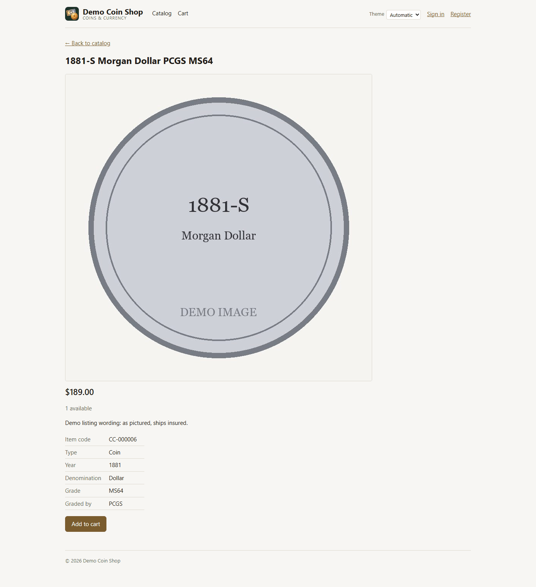

The cart holds what a customer means to buy. **Place order** records the order, and
payment is arranged outside the system.

**Orders** lists the signed-in customer's own orders and their status:

Customers sign in or register here. An account made this way is always a customer.

The shop rearranges itself to fit a phone:

